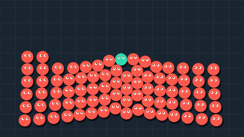
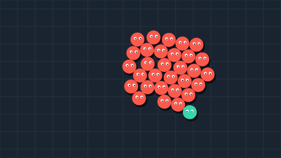

# ECS Enemy

Небольшой демопроект на Unity. Показывает применение **Entity Component System (ECS)** на примере арены с игроком и преследующими его врагами.

Игровая логика реализована на **Morpeh ECS**: компоненты хранят состояние сущностей, системы обрабатывают движение, бой и жизненный цикл врагов. Unity GameObject используются для визуального представления.

Графика, визуальные эффекты и шейдеры созданы с использованием **GPT-6 Astra**.

## Демонстрация

### Круговая атака

Урон по области, отбрасывание и визуальные эффекты.


### Система врагов

Преследование игрока и разделение персонажей на арене.



## Возможности

- Движение игрока в пределах арены.
- Преследование игрока врагами.
- Разделение пересекающихся персонажей с поиском соседей через пространственную сетку.
- Круговая атака с перезарядкой, уроном и отбрасыванием.
- Удаление побеждённых врагов и повторное появление с задержкой.
- Пул объектов для повторного использования визуальных объектов врагов.
- Визуальные эффекты атаки и попаданий, анимация глаз и моргания.
- Настройка игровых параметров через ScriptableObject-конфиги.

В конфигурации стартовой сцены настроено **80 врагов**, задержка повторного появления — **10 секунд**.

## Технологии

| Технология | Версия |
| --- | --- |
| Unity | 6000.0.80f1 (Unity 6) |
| Morpeh ECS | 2024.1.1 |
|  |

Язык: **C#**. Зависимости указаны в [Packages/manifest.json](Packages/manifest.json).

## Архитектура

- **Компоненты** описывают данные: позицию, движение, здоровье, цель преследования и параметры атаки.
- **Системы** выбирают сущности через фильтры Morpeh и обрабатывают соответствующую логику.
- **Сущности-запросы** связывают этапы атаки, нанесения урона, создания и удаления врагов.
- **Представление** синхронизирует ECS-позиции с Transform и отображает боевые эффекты.
- **Пул врагов** разделён на `EnemyPoolPresenter`, управляющий выдачей и возвратом объектов, и `EnemyPoolView`, работающий с Unity-объектами.
- **ScriptableObject-конфиги** хранят параметры игры, ввода и визуальных эффектов. `GameConfig` объединяет ссылки на конфиги, которые передаются в инициализатор и системы; параметры и обязательные ссылки проверяются при валидации и запуске.

`MorpehBootstrap` создаёт ECS-мир и управляет его жизненным циклом. `SceneInitializer` создаёт игрока и запросы на появление врагов. Порядок выполнения систем задан в `GameplaySystems.Register`.

Пространственная сетка используется для поиска соседей при разделении персонажей. Проверка попаданий круговой атаки выполняется отдельной системой по расстоянию до врагов.

### Структура кода

```text
Assets/Scripts/
├── Bootstrap/          # Создание мира, инициализация и регистрация систем
├── Configs/            # ScriptableObject-конфиги и их валидация
├── ECS/
│   ├── Components/     # Данные, теги и запросы
│   ├── Spatial/        # Пространственная сетка и границы арены
│   └── Systems/
│       ├── Combat/       # Атаки, урон и обнаружение смерти
│       ├── Enemy/        # Преследование, появление и удаление врагов
│       ├── Movement/     # Движение, отбрасывание и разделение персонажей
│       ├── Player/       # Ввод игрока
│       └── Presentation/ # Синхронизация Transform, камера и анимации
├── Effects/            # Боевые визуальные эффекты
├── Presenters/Pool/    # Управление пулом врагов
└── Views/              # Unity-компоненты представления
```

## Запуск

1. Клонируйте репозиторий.
2. Установите **Unity 6000.0.80f1** через Unity Hub и добавьте папку проекта.
3. Откройте проект и дождитесь импорта ресурсов и установки пакетов.
4. Откройте сцену [Assets/Scenes/EcsStarter.unity](Assets/Scenes/EcsStarter.unity).

## Управление

| Действие | Клавиши |
| --- | --- |
| Движение | WASD или стрелки |
| Круговая атака | Пробел |

Каждая атака требует отдельного нажатия. В текущем конфиге перезарядка 0,25 секунды. Привязки задаются в [PlayerControls.inputactions](Assets/Settings/Gameplay/PlayerControls.inputactions), на который ссылается `InputConfig`.
